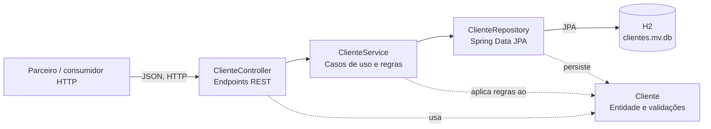

# API de Clientes para Parceiros

API REST para consulta e manutenção de clientes de uma empresa de vendas online, desenvolvida em Java 21 com Spring Boot 3.5.16. A aplicação segue MVC e utiliza Spring Data JPA com H2 em modo arquivo para manter os dados entre reinicializações.

## Executar

Requisitos: JDK 21 e Maven 3.6.3 ou superior.

```bash
mvn spring-boot:run
```

A API inicia em `http://localhost:8080`. Para alterar a porta, defina a variável de ambiente `PORT`. A base H2 é criada automaticamente em `data/clientes.mv.db`.

## Endpoints

Os recursos são representados em JSON. Cliente tem `id`, `nome`, `email`, `telefone`, `criadoEm` e `atualizadoEm`. Nome e email são obrigatórios; emails são normalizados para minúsculas e não podem se repetir.

| Método | Rota | Resposta |
|---|---|---|
| GET | `/clientes` | Lista todos os clientes |
| GET | `/clientes/contar` | `{ "total": n }` |
| GET | `/clientes/{id}` | Cliente pelo identificador |
| GET | `/clientes/nome/{nome}` | Busca parcial sem distinção de maiúsculas/minúsculas |
| POST | `/clientes` | Cria cliente (`201 Created`) |
| PUT | `/clientes/{id}` | Atualiza cliente |
| DELETE | `/clientes/{id}` | Exclui cliente (`204 No Content`) |

Exemplo de criação:

```bash
curl -X POST http://localhost:8080/clientes \
  -H 'content-type: application/json' \
  -d '{"nome":"Ana Silva","email":"ana@example.com","telefone":"11999990000"}'
```

Dados inválidos retornam `400`, identificadores inexistentes retornam `404` e emails duplicados retornam `409`. Os erros são apresentados em JSON, com detalhes de validação quando aplicável.

## Arquitetura

Diagrama de componentes (visão simplificada baseada no C4):



O fluxo de aplicação é `Controller → Service → Repository`. O Controller traduz HTTP para chamadas da aplicação; o Service valida regras e coordena os casos de uso; o Repository abstrai o acesso a dados; e o Model representa a entidade persistida e suas restrições. Spring Boot configura o servidor e conecta as camadas.

## Estrutura do projeto

```text
.
├── data/                                  # Banco H2 criado em tempo de execução
├── src/main/java/com/exemplo/api/
│   ├── controller/
│   │   ├── ClienteController.java         # Endpoints HTTP
│   │   └── ApiExceptionHandler.java       # Respostas de erro da API
│   ├── model/
│   │   └── Cliente.java                   # Entidade e validações
│   ├── repository/
│   │   └── ClienteRepository.java         # Consultas com Spring Data JPA
│   ├── service/
│   │   └── ClienteService.java            # Regras e casos de uso
│   └── ApiApplication.java                # Inicialização Spring Boot
├── src/main/resources/
│   └── application.properties             # Configuração da aplicação e H2
├── pom.xml                                # Dependências e build Maven
└── README.md
```

O banco H2 em arquivo atende à demonstração e mantém persistência local. Para um ambiente de produção com múltiplas instâncias, configure um banco servidor como PostgreSQL e credenciais externas à aplicação.
